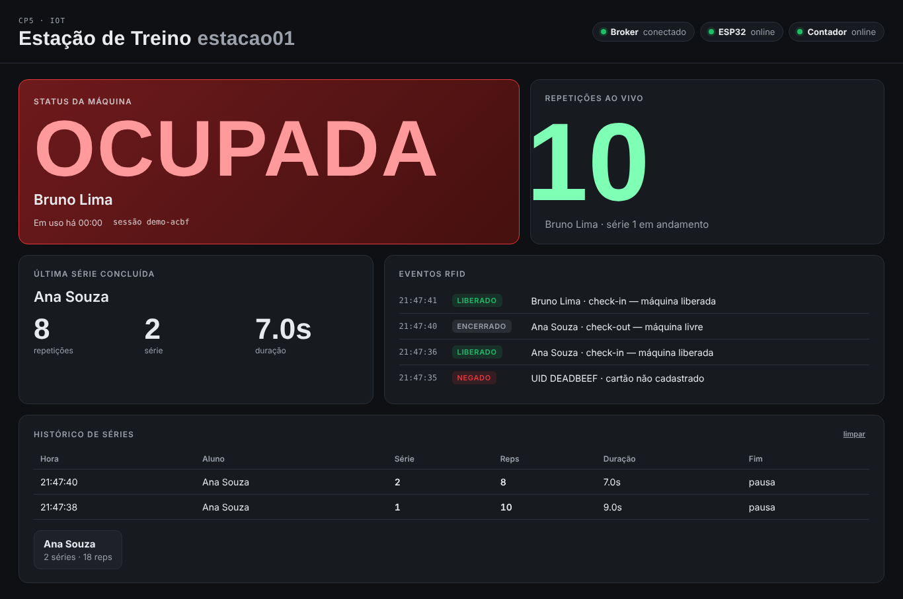
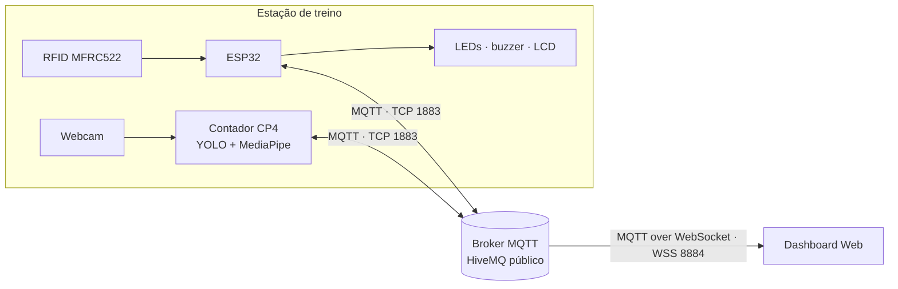

# 🏋️ Estação de Treino IoT — CP5

> **Conectividade IoT e Telemetria em Nuvem** · Controle de acesso por RFID, contagem de
> repetições por visão computacional e dashboard em tempo real usando **MQTT (Publish/Subscribe)**.



## Equipe

**Ronaldos FC** — Turma 3ESPZ

| Nome | RM |
|---|---|
| Bruno Carneiro Leão | RM555563 |
| João Victor Franco | RM556790 |
| Rodrigo Jimenez | RM558148 |
| Ruan Melo | RM557599 |
| Lucca Borges | RM554608 |

## Sumário

- [Equipe](#equipe)
- [O que o sistema faz](#o-que-o-sistema-faz)
- [Arquitetura](#arquitetura)
- [Tópicos MQTT](#tópicos-mqtt)
- [Estrutura do repositório](#estrutura-do-repositório)
- [Como executar](#como-executar)
- [Decisões técnicas](#decisões-técnicas)
- [Limitações e melhorias futuras](#limitações-e-melhorias-futuras)

## O que o sistema faz

| Requisito do CP5 | Como foi atendido |
|---|---|
| Protocolo MQTT (Publish/Subscribe) | ESP32, contador e dashboard são clientes MQTT independentes ligados ao broker `broker.hivemq.com` |
| Validação de acesso via RFID | ESP32 + MFRC522 compara o UID com a lista de alunos cadastrados; libera, nega ou faz check-out |
| Dashboard com status em tempo real (verde/vermelho) | Página web com MQTT.js: card **verde = LIVRE**, **vermelho = OCUPADA** |
| Nome do aluno e volume de repetições ao final da série | O contador do CP4 publica `{aluno, serie, reps, duracao}` no tópico `/serie` ao final de cada série |

Recursos extras: contagem **ao vivo** a cada repetição, LCD no ESP32, detecção de
dispositivo **offline** (LWT), liberação automática por inatividade, histórico e
resumo por aluno, simulador para testes sem hardware.

## Arquitetura



1. O aluno aproxima o cartão. O **ESP32** valida o UID, acende o LED vermelho e publica
   `status = ocupada` com o nome do aluno.
2. O **contador** (CP4) assina `status`: só conta repetições enquanto a máquina estiver
   liberada **e** o equipamento estiver no frame.
3. A cada repetição publica em `reps`; após **8 s sem repetição** fecha a série e publica
   o volume em `serie`.
4. O **dashboard** assina tudo (`estacao01/#`) e atualiza a tela instantaneamente.
5. O aluno passa o cartão de novo (check-out) → `status = livre` → tudo volta para verde.

Detalhes, diagramas de sequência e máquina de estados: **[docs/arquitetura.md](docs/arquitetura.md)**.

## Tópicos MQTT

Prefixo: `fiap/cp5/ronaldos-fc/estacao01`

| Tópico | Publicador | QoS | Retido | Exemplo de payload |
|---|---|---|---|---|
| `status` | ESP32 | 0 | ✅ | `{"estado":"ocupada","aluno":"Ana Souza","uid":"A1B2C3D4","sessao":"3f9a-0002"}` |
| `acesso` | ESP32 | 0 | — | `{"uid":"DEADBEEF","aluno":"","resultado":"negado"}` |
| `reps` | Contador | 0 | — | `{"sessao":"3f9a-0002","aluno":"Ana Souza","serie":2,"reps":7}` |
| `serie` | Contador | 1 | — | `{"aluno":"Ana Souza","serie":2,"reps":12,"duracao_s":31.4,"motivo":"pausa"}` |
| `esp32/online` | ESP32 (LWT) | 0 | ✅ | `online` / `offline` |
| `contador/online` | Contador (LWT) | 1 | ✅ | `online` / `offline` |

## Estrutura do repositório

```
cp5-estacao-iot/
├── firmware/estacao_esp32/      # ESP32 (Arduino C++)
│   ├── estacao_esp32.ino        #   RFID, máquina de estados, MQTT
│   ├── config.h                 #   Wi-Fi, broker, tópicos, pinos, cartões cadastrados
│   ├── diagram.json             #   circuito do Wokwi
│   ├── libraries.txt            #   bibliotecas do Wokwi
│   └── wokwi.toml               #   (opcional) Wokwi no VS Code
├── visao/                       # Contador de repetições (Python)
│   ├── cp5_contador_mqtt.py     #   CP4 (YOLO + MediaPipe) + integração MQTT
│   ├── mqtt_estacao.py          #   cliente MQTT: sessão, reps, fechamento de série
│   ├── config.py                #   parâmetros de visão e MQTT
│   └── requirements.txt
├── dashboard/                   # Painel web (HTML + CSS + JS puro)
│   ├── index.html
│   ├── style.css
│   ├── app.js                   #   cliente MQTT.js e renderização
│   └── config.js                #   URL do broker e tópico base
├── tools/
│   └── simulador.py             # monitor de tópicos, contador simulado e demo completa
└── docs/
    ├── arquitetura.md           # contrato MQTT, sequência e estados
    ├── montagem.md              # passo a passo do hardware físico
    ├── roteiro-apresentacao.md  # roteiro da demo + perguntas técnicas
    └── img/
```

## Como executar

### 0. Escolha um tópico base único

O broker é público. Troque `ronaldos-fc` por um identificador do seu grupo **nos três arquivos**:

| Arquivo | Linha |
|---|---|
| `firmware/estacao_esp32/config.h` | `#define TOPICO_BASE "fiap/cp5/ronaldos-fc/estacao01"` |
| `visao/config.py` | `TOPICO_BASE = "fiap/cp5/ronaldos-fc/estacao01"` |
| `dashboard/config.js` | `TOPICO_BASE: "fiap/cp5/ronaldos-fc/estacao01"` |

### 1. ESP32 no Wokwi (simulação)

1. Acesse <https://wokwi.com/projects/new/esp32>.
2. Substitua o conteúdo de `sketch.ino` pelo de `firmware/estacao_esp32/estacao_esp32.ino`.
3. Crie os arquivos `config.h` e `libraries.txt` (botão **▾ → New file**) e cole o conteúdo.
4. Substitua o `diagram.json` pelo do repositório.
5. Clique em **▶ Start**. O Serial Monitor mostra `[MQTT] Conectado!`.
6. Os **botões fazem o papel dos cartões** (o Wokwi não tem leitor MFRC522):

   | Botão | Cartão | Resultado |
   |---|---|---|
   | 🟢 Verde | Ana Souza (`A1B2C3D4`) | libera / check-out |
   | 🔵 Azul | Bruno Lima (`B5C6D7E8`) | libera / check-out |
   | 🔴 Vermelho | Desconhecido (`DEADBEEF`) | acesso negado |

   Também é possível digitar um UID no Serial Monitor e apertar Enter.

### 2. ESP32 físico

Mude `SIMULAR_RFID` para `0`, configure o Wi-Fi e siga o
**[guia de montagem](docs/montagem.md)** (ligações, gravação e cadastro dos cartões).

### 3. Contador de repetições (webcam)

```bash
cd visao
python -m venv .venv && source .venv/bin/activate   # Windows: .venv\Scripts\activate
pip install -r requirements.txt
python cp5_contador_mqtt.py
```

Teclas: `q` sair · `f` finalizar série · `r` zerar série · `b` trocar braço.
Opções: `python cp5_contador_mqtt.py --help` (`--cam`, `--base`, `--pausa`, ...).

### 4. Dashboard

Abra `dashboard/index.html` no navegador (duplo clique já funciona). Para servir localmente:

```bash
python -m http.server 8000 --directory dashboard   # http://localhost:8000
```

**Publicar no GitHub Pages** (para abrir no celular durante a apresentação):
*Settings → Pages → Deploy from a branch → `main` / `(root)`*. O painel fica em
`https://<usuario>.github.io/<repositorio>/dashboard/`.

### 5. Testar sem hardware e/ou sem câmera

```bash
pip install paho-mqtt
python tools/simulador.py monitor    # mostra todo o tráfego MQTT da estação
python tools/simulador.py contador   # gera repetições quando o RFID (Wokwi) libera
python tools/simulador.py demo       # simula ESP32 + contador com um roteiro completo
```

## Decisões técnicas

- **Separação de responsabilidades.** O ESP32 cuida do que é tempo real e físico (RFID,
  LEDs, buzzer); a visão computacional roda no PC, pois YOLO e MediaPipe não cabem em um
  microcontrolador. O MQTT liga as duas partes sem acoplamento.
- **Contagem habilitada pelo RFID.** O contador só avança a máquina de estados quando
  recebe `status = ocupada`, então ninguém soma repetições sem estar identificado.
- **Mensagens retidas em `status` e `*/online`.** Um dashboard aberto a qualquer momento
  recebe o estado atual imediatamente.
- **QoS por importância do dado.** `reps` em QoS 0 (alta frequência, a próxima corrige a
  anterior) e `serie` em QoS 1 (dado de negócio). Duplicatas são descartadas no dashboard
  pela chave `sessao + serie`. *A PubSubClient do ESP32 publica apenas em QoS 0.*
- **LWT (Last Will and Testament).** Se o ESP32 ou o contador caírem, o broker publica
  `offline` e o dashboard mostra o card **OFFLINE**.
- **ID de sessão.** Cada check-in gera um ID; mensagens de sessões antigas são ignoradas,
  evitando que repetições "atrasadas" caiam na sessão do próximo aluno.
- **Fim de série em 3 situações.** Pausa de 8 s sem repetição, check-out no RFID ou
  tecla `f`. O motivo vai no payload (`pausa`, `checkout`, `manual`).
- **Dashboard sem back-end e seguro contra injeção.** O navegador conecta direto ao broker
  via WSS; todo texto recebido é inserido com `textContent`, nunca `innerHTML`.
- **Firmware não bloqueante.** Reconexão de Wi-Fi (5 s) e MQTT (3 s) sem travar a leitura do RFID;
  antirrepique de 2 s para o mesmo cartão; liberação automática após 3 min sem atividade.

### Testes realizados

- Firmware compilado com `arduino-cli` (core ESP32) nos dois modos — `SIMULAR_RFID 1` e `0` — sem avisos.
- Lógica do contador (`mqtt_estacao.py`) testada contra um broker local: bloqueio sem RFID,
  contagem ao vivo, fechamento por pausa e por check-out, republicação de status sem zerar a série, LWT.
- Dashboard testado em navegador headless (desktop e celular) com o roteiro do `simulador.py demo`.

## Limitações e melhorias futuras

- Broker público sem autenticação: em produção usar broker próprio com usuário/senha,
  **TLS (8883)** e ACL por tópico.
- Cartões cadastrados no firmware: poderiam vir de um banco de dados via tópico de configuração.
- Histórico guardado só no navegador (`localStorage`): persistir em banco (ex.: InfluxDB/Node-RED) para relatórios.
- O YOLO detecta "cell phone" como equipamento: treinar um modelo com a classe "halter".
- Várias estações: basta mudar `ESTACAO_ID` e o dashboard pode assinar `fiap/cp5/ronaldos-fc/+/status`.
