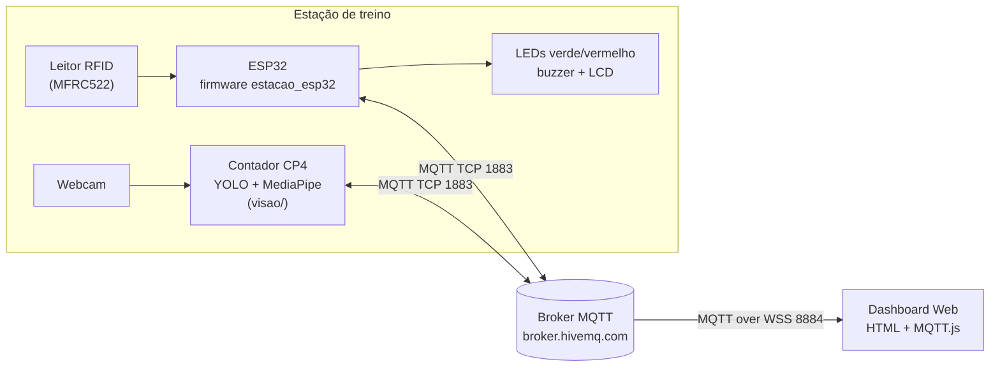
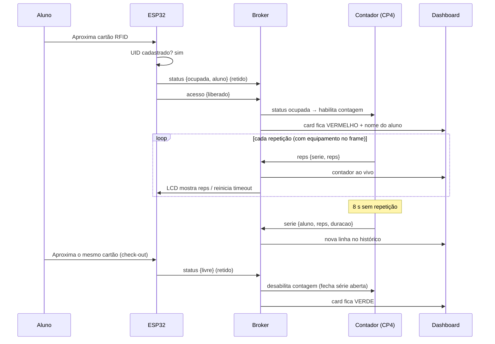
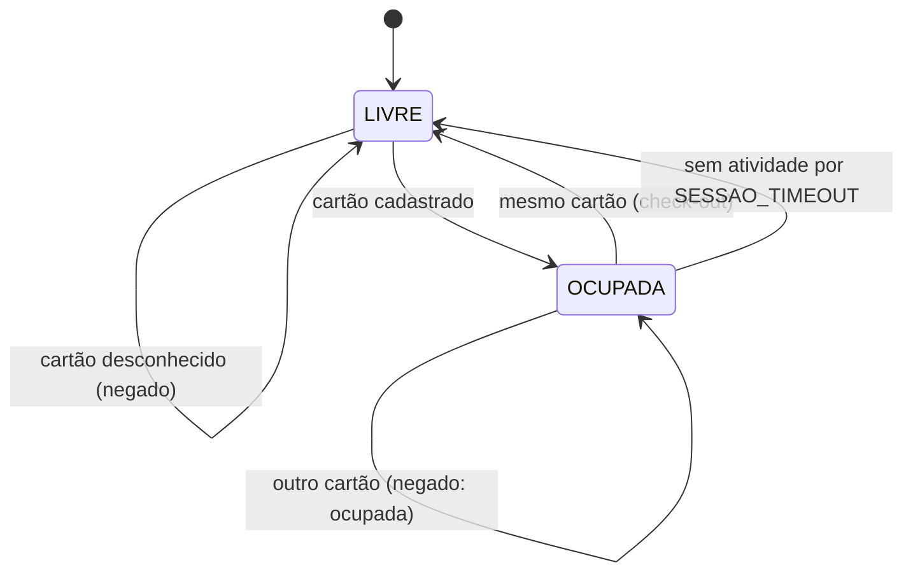

# Arquitetura e Contrato MQTT

## Visão geral



Três clientes MQTT, cada um com uma responsabilidade:

| Cliente | Publica | Assina | Responsabilidade |
|---|---|---|---|
| **ESP32** (`firmware/`) | `status`, `acesso`, `esp32/online` | `reps`, `serie` | Controle de acesso por RFID e estado da máquina (livre/ocupada) |
| **Contador** (`visao/`) | `reps`, `serie`, `contador/online` | `status` | Conta repetições por visão computacional **somente com a máquina liberada** e fecha a série |
| **Dashboard** (`dashboard/`) | — | `#` (tudo da estação) | Exibe em tempo real o status, o aluno, as repetições e o histórico |

Nenhum cliente fala diretamente com outro: todos se comunicam pelo broker
(**desacoplamento do modelo Publish/Subscribe**). Por isso o contador pode rodar em
qualquer PC e o dashboard em qualquer navegador.

## Tópicos

Prefixo base (configurável): `fiap/cp5/ronaldos-fc/estacao01`

| Tópico | Quem publica | QoS | Retido | Quando |
|---|---|---|---|---|
| `{base}/status` | ESP32 | 0 | **sim** | Toda mudança de estado (e no boot) |
| `{base}/acesso` | ESP32 | 0 | não | Toda leitura de cartão |
| `{base}/reps` | Contador | 0 | não | A cada repetição (contagem ao vivo) |
| `{base}/serie` | Contador | 1 | não | Ao final de cada série |
| `{base}/esp32/online` | ESP32 (LWT) | 0 | **sim** | `online` ao conectar / `offline` pelo broker se cair |
| `{base}/contador/online` | Contador (LWT) | 1 | **sim** | Idem |

> **Por que `status` é retido?** Um dashboard aberto *depois* da última mudança recebe
> imediatamente o estado atual da máquina, sem esperar o próximo evento.
>
> **Por que `serie` usa QoS 1?** É o dado de negócio (volume do treino); QoS 1 garante
> entrega *pelo menos uma vez*. A biblioteca PubSubClient do ESP32 só publica em QoS 0,
> por isso os tópicos do ESP32 são QoS 0.
>
> **LWT (Last Will and Testament):** ao conectar, cada dispositivo registra no broker uma
> "mensagem de testamento". Se a conexão cair sem desconexão limpa, o próprio broker
> publica `offline` — o dashboard detecta dispositivos fora do ar.

## Payloads (JSON)

### `status`
```json
{ "estado": "livre", "estacao": "estacao01" }
```
```json
{ "estado": "ocupada", "estacao": "estacao01",
  "aluno": "Ana Souza", "uid": "A1B2C3D4", "sessao": "3f9a-0002" }
```

### `acesso`
```json
{ "uid": "A1B2C3D4", "aluno": "Ana Souza", "resultado": "liberado" }
```
`resultado` ∈ `liberado` · `encerrado` (check-out) · `negado` (cartão não cadastrado) ·
`ocupada` (outro aluno tentou usar a máquina em uso) · `timeout` (liberada por inatividade).

### `reps`
```json
{ "sessao": "3f9a-0002", "aluno": "Ana Souza", "serie": 2, "reps": 7 }
```

### `serie`
```json
{ "sessao": "3f9a-0002", "aluno": "Ana Souza", "uid": "A1B2C3D4",
  "serie": 2, "reps": 12, "duracao_s": 31.4, "motivo": "pausa" }
```
`motivo` ∈ `pausa` (sem repetições por N segundos) · `checkout` (aluno passou o cartão para
sair) · `manual` (tecla `f` no contador).

## Fluxo de uma sessão



## Máquina de estados do ESP32


